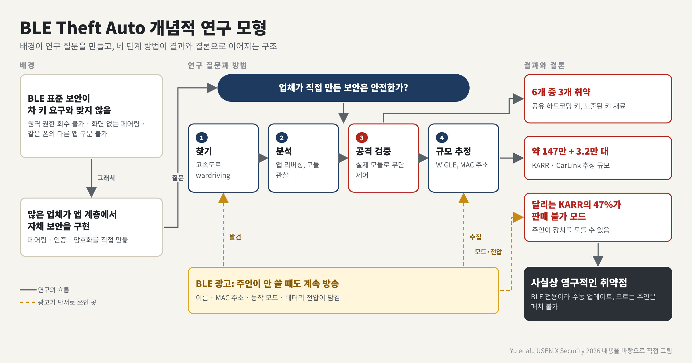
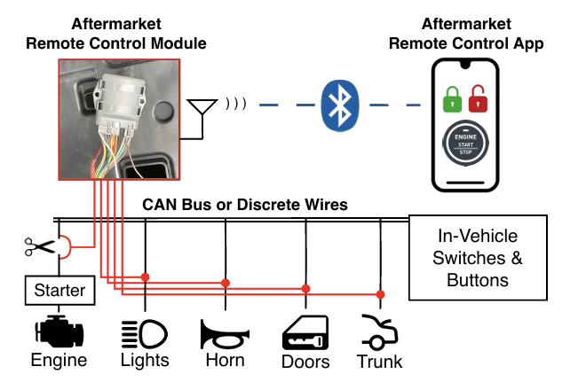
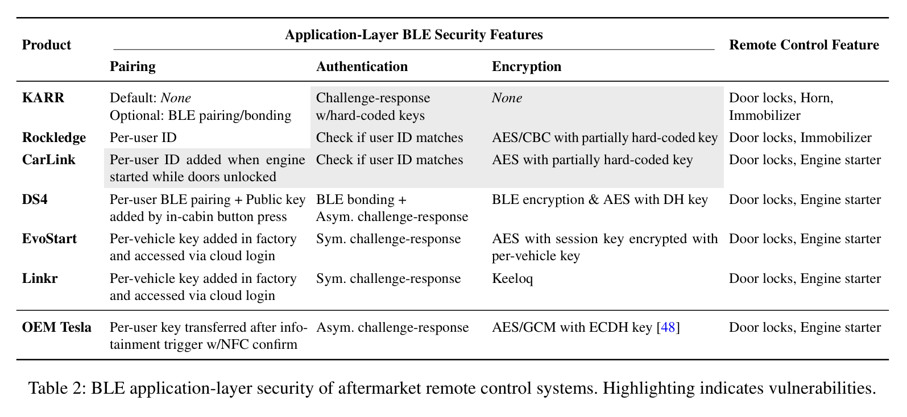
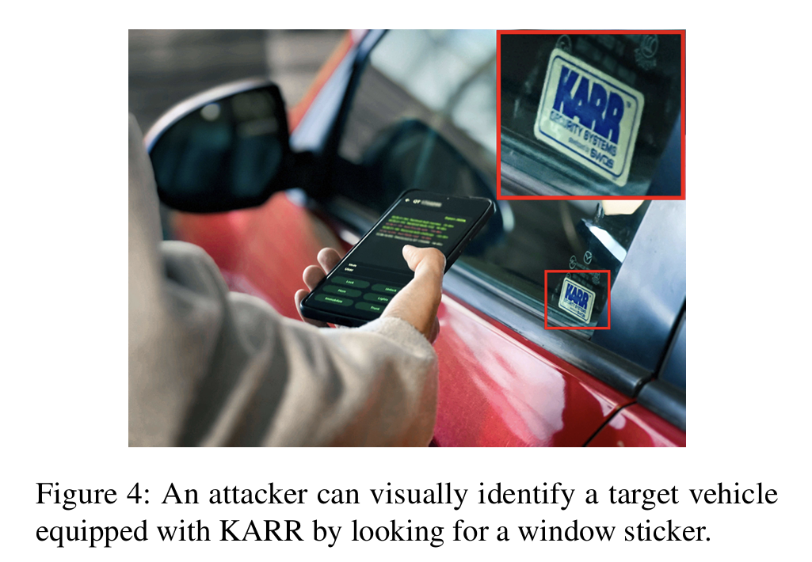
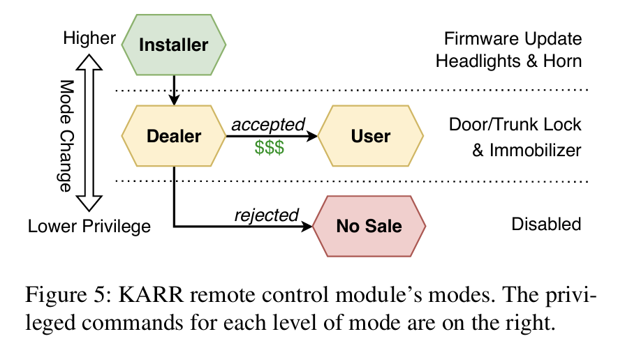

## 들어가며

- 논문: BLE Theft Auto: Evaluating the Security of Aftermarket BLE-based Automotive Remote Control Systems
- 저자: Jerry Yu, Yibo Wei 외 (UC San Diego)
- 학회: USENIX Security Symposium 2026
- 원문: https://www.usenix.org/conference/usenixsecurity26/presentation/yu-jerry

미션을 시작하며 어떤 논문을 리뷰해야 할까 고민이 많았다. 그래서 일단 평소 관심 있던 임베디드, 시스템, 취약점 분야를 중심으로 논문을 찾아봤지만 딱 꽂히는 게 없었다. 조건을 넣어 AI에게 추천을 받아도 마찬가지여서, 반대로 AI가 나에게 질문하게 하고 소거법으로 좁혀 나갔다. 보안 전체에서 시작해 범위를 줄여 간 끝에 찾은 것이 이 논문이다. 큰 시스템이나 기능이 많은 장치는 아직 배경지식이 부족해 버거울 것 같다고 생각하던 참이었는데, 이 논문은 OEM이 아닌 애프터마켓이라는, 생각해 본 적 없는 분야를 다뤄서 더 끌렸다.

*Yu et al., USENIX Security 2026 다이어그램*

### 논문을 읽기 전 정리

**이 논문이 다루는 문제는 무엇인가?**
차 회사가 아니라 딜러나 개인이 나중에 따로 다는 애프터마켓 BLE 원격 제어 장치의 보안 문제다. 스마트폰 앱으로 문을 열고 시동을 거는 이 장치들이 정말 안전한지를 다룬다.

**왜 이 문제가 중요한가?**
이 장치는 문, 시동처럼 차에서 가장 민감한 기능을 직접 다룬다. 게다가 딜러가 미리 달아 두는 경우 차 주인은 장치가 있는지도 모를 수 있다. 모르는 장치는 고칠 수도 없다.

**기존 방식들은 무엇이 부족했는가?**
테슬라 같은 제조사 시스템은 연구가 많이 됐지만, 애프터마켓 장치는 거의 들여다본 사람이 없었다. 업체들이 검증된 BLE 표준 보안 대신 자체 보안을 만들어 쓰는데, 그 보안이 제대로 검증되지 않았다.

읽기 전에는 "보안이 허술한 장치" 정도로 생각했다. 다 읽고 나니 허술함 자체보다, 고칠 수도 없고 주인도 모를 수 있다는 점이 더 크게 다가왔다.

## 기: 내 차에 숨어 있는 장치

### 애프터마켓과 OEM

애프터마켓(aftermarket)은 신차가 판매된 뒤 차량의 유지, 수리, 개조에 쓰이는 부품·용품·서비스 시장을 말한다. 차 제조사가 아닌 업체가 만든 블랙박스나 원격시동기를 출고 후에 다는 것이 여기에 속한다. 반대로 OEM(Original Equipment Manufacturer)은 자동차 업계에서 완성차 제조사를 뜻하고, 공장에서 처음부터 달려 나오는 부품을 순정(OEM) 부품이라 부른다. 논문에서 "OEM 시스템"은 테슬라, 리비안처럼 차 회사가 직접 넣은 원격 제어 시스템을 가리킨다.

이 논문이 다루는 장치는 스마트폰 앱을 차 키처럼 쓰게 해 주는 애프터마켓 모듈이다. 앱이 BLE(Bluetooth Low Energy, 저전력 블루투스)로 모듈에 명령을 보내면, 모듈이 문 잠금, 경적, 전조등, 시동, 이모빌라이저(immobilizer, 시동을 걸 수 없게 막는 도난 방지 장치)를 움직인다. 인터넷이 없어도 가까이서 차를 제어할 수 있다는 게 장점이다.

### 배선에 직접 끼워 넣는 장치

읽으면서 처음 놀란 건 이 장치가 차에 연결되는 방식이었다. 차는 문 잠금이나 시동 같은 민감한 기능을 외부에 열어 두지 않고, 진단 단자(OBD-II)로도 이 기능에 접근할 수 없다. 그래서 애프터마켓 모듈은 대시보드 아래에 숨겨져 점화 배선과 CAN 버스를 직접 따거나 잘라서 연결된다. 저자들은 이를 사실상 차의 기본 보안을 우회하는 "정당한 하드웨어 임플란트"로 본다.

*그림 1. 애프터마켓 원격 제어 모듈 구조 (출처: Yu et al., USENIX Security 2026, Figure 1)*

그림 1을 보다가 시동 쪽만 선이 잘려 있는 게 눈에 띄었다. 왜 거기만 끊어 놨을까? 논문은 모듈이 공장 배선을 "따거나 잘라서(tapping or cutting)" 연결된다고만 하고 이유는 설명하지 않는다. 그래서 따로 찾아보며 이렇게 이해했다. 조명, 경적, 문 잠금 같은 부가 기능은 기존 선에 신호를 덧대기만 해도 켜고 끌 수 있다. 하지만 시동은 차에서 가장 중요한 기능이라, 기존 회로가 그대로 살아 있으면 옆에서 신호를 더하는 것만으로는 시동을 막거나 제어하기 어렵다. 선을 끊고 그 중간에 모듈을 넣어야 전기가 흐를지 말지를 모듈이 직접 정할 수 있다. 실제로 애프터마켓 이모빌라이저는 점화, 연료 펌프, 시동 모터 같은 회로를 중간에서 가로채는(intercept) 방식으로 동작한다.

차 보안은 "차 안 배선까지 손댈 수 있는 사람은 믿는다"는 전제 위에 있었던 셈이다. 누가 배선에 손을 댈 수 있다는 것까지 고려해야 한다는 건 깊게 생각해 본 적이 없던 부분이다.

### 왜 BLE 표준 보안을 쓰지 않을까

BLE에는 페어링(pairing, 서로를 믿을 상대로 등록하고 키를 나눠 갖는 과정), 인증, 암호화를 위한 표준 보안이 이미 있다. 오랫동안 검증되고 고쳐져 온 기능이다. 그런데 논문에 따르면 많은 차 원격 제어 업체가 이 표준 보안을 쓰지 않고 앱 계층에서 자체 보안을 만든다. 이유는 차 키에 필요한 기능을 표준 보안으로는 만들 수 없기 때문이다.

먼저 알아 둘 점이 있다. BLE 페어링 정보는 앱이 아니라 스마트폰 OS(안드로이드, iOS)가 관리한다. 앱은 OS가 허락한 범위 안에서만 페어링을 다룰 수 있다. 처음 읽을 때는 여기서 말하는 OS를 차량 OS로 오해했는데, 스마트폰 OS였다. 이 점을 알고 나면 세 가지 이유가 이해된다.

- 원격 권한 회수: 업체는 자기 서버에서 "이 사람의 차 접근 권한을 회수"하고 싶다. 하지만 OS는 앱이 BLE 페어링을 지우는 기능을 제공하지 않는다. 사용자가 직접 블루투스 설정에서 지우거나 차 옆에서 지워야 한다.
- 화면 없는 페어링: 중간자 공격을 막는 숫자 비교(Numeric Comparison) 방식은 양쪽 화면에 뜬 숫자를 사람이 확인해야 한다. 대시보드 뒤 모듈에는 화면이 없다.
- 같은 폰의 다른 앱: 페어링은 OS가 폰 단위로 저장하기 때문에, 한번 페어링되면 같은 폰의 어떤 앱이든 그 연결을 쓸 수 있다. 명령을 보낸 게 공식 앱인지 악성 앱인지는 BLE 표준 보안이 구분해 주지 않는다. 그래서 "공식 앱이 보낸 명령인지"는 앱 계층에서 따로 확인해야 하고, 업체 입장에서는 표준 보안을 켜도 자체 인증을 또 만들어야 한다.

이런 이유로 많은 업체가 BLE 보안을 가장 낮은 단계로 내려 두고 페어링, 인증, 암호화를 직접 만든다. 그렇다면 업체들이 직접 만든 보안은 안전할까? 이 논문은 이 질문에서 출발한다.

## 승: 지나가는 차의 신호를 모으다

### 핵심 아이디어: BLE 광고

BLE 기기는 주변에 "나 여기 있어요"라는 신호를 주기적으로 방송한다. 이를 광고(advertisement)라고 한다. 폰이 기기에 연결하려면 그 기기의 주소를 알아야 하는데, 처음에는 근처에 어떤 기기가 있는지, 주소가 무엇인지 알 방법이 없다. 전화를 걸려면 상대 번호를 알아야 하는 것과 같다. 그래서 폰은 먼저 주변 방송을 듣고(스캔), 방송에 담긴 주소를 확인한 뒤에야 연결을 요청할 수 있다.

처음엔 "이용자가 쓸 때만 반응하면 되지 왜 계속 방송하지?"가 궁금했다. 어차피 주인이 차 근처에서 앱을 켜니, 모듈은 조용히 기다리다가 폰이 보낸 신호를 받을 때만 깨어나는 쪽이 전력을 덜 쓸 거라고 생각했다. 계속 내보내는 쪽보다 받기만 하는 쪽이 당연히 효율적일 것 같았다.

그런데 실제로는 반대였다. 신호가 왔는지 알려면 모듈이 수신기를 켜고 계속 듣고 있어야 한다. 수신기가 꺼져 있으면 누가 불러도 들을 수 없다. 게다가 BLE 칩은 받을 때도 보낼 때만큼 전기를 쓴다. 그래서 계속 듣고 있는 것보다, 짧은 광고를 띄엄띄엄 보내고 그 직후에만 잠깐 듣는 쪽이 전력을 훨씬 덜 쓴다. 폰의 연결 요청은 바로 이 짧은 틈에 들어간다. 기다리는 쪽이 아니라 먼저 알리는 쪽이 더 효율적이라는 게 신기했다. 주차된 차의 배터리로 오래 버텨야 하는 모듈에게는 중요한 차이다.

저자들의 핵심 아이디어는 여기서 나온다. 애프터마켓 모듈은 차 주인이 앱을 쓰지 않을 때도 계속 광고를 방송한다. 그러니 지나가며 신호를 수집하는 것만으로 어떤 차에 어떤 장치가 달려 있는지 알 수 있다. 전력을 아끼려고 택한 방송 구조가 그대로 연구의 출발점이 된 것이다.

### 찾기: 고속도로 wardriving

연구팀은 BLE 광고를 원본 그대로 수집하는 앱을 직접 만들고, 샌디에이고의 고속도로를 달리며 신호를 모았다. 이렇게 돌아다니며 무선 신호를 수집하는 것을 wardriving이라고 한다.

연구팀은 모은 데이터를 정리하면서 고속도로에서 나온 신호만 남겼다. 지도 데이터(OpenStreetMap)에서 고속도로(motorway)로 표시된 도로를 골라, 도로 중심선에서 50m 안을 고속도로로 보고, 그 안에서 잡힌 신호만 남기는 방식이다. 이 과정에서 37만 2,922개였던 기기(MAC 주소 기준)가 4,314개로 줄었다.

고속도로를 고른 이유가 좋았다. 고속도로에는 보행자나 자전거가 들어올 수 없으니, 거기서 잡힌 신호는 대부분 차에서 나온 것이다. 도심이나 주거지처럼 BLE 신호가 뒤섞인 곳의 데이터는 아예 빼 버리니, 남은 신호가 차에서 나온 건지 하나하나 따질 필요가 없어진 셈이다.

남은 신호를 광고 구조와 이름 패턴으로 묶자 267개 무리가 나왔다. 가장 큰 무리는 테슬라(1,506개)였고, 두 번째가 608개의 KARR였다. KARR는 애프터마켓 장치인데도 테슬라, 리비안 같은 제조사 시스템 사이에서 손꼽힐 만큼 흔하게 잡혔다. 미국은 무선 제품의 설명서를 FCC에 공개하는데, KARR는 그 서류에서도 "블루투스 센서"라는 이름으로 정체가 잘 드러나지 않았다. 연구팀은 이후 앱 스토어를 뒤져 비슷한 장치를 더 찾았고, 총 6개의 애프터마켓 시스템(KARR, Rockledge, CarLink, DS4, EvoStart, Linkr)을 분석 대상으로 삼았다.

KARR는 딜러가 매장의 차에 일괄로 다는 장치다. 딜러는 시승할 차를 앱으로 열고, 이모빌라이저로 도난을 막고, 고객에게 업그레이드로 팔고, 보험 할인도 받는다. 그래서 KARR 애프터마켓 시스템은 기아, 혼다, 도요타, 마쓰다, 포드 딜러를 통해 널리 퍼졌다.

### 분석하기: 앱 리버싱과 모듈 관찰

각 시스템의 안드로이드 앱(APK)을 JADX로 디컴파일해 자체 BLE 프로토콜을 분석했다. 한 앱은 BLE 프로토콜을 C#으로 만들어 .NET DLL로 넣어 두어서 ILSpy로 따로 풀었는데, 저자들은 안드로이드에서 Java가 아닌 라이브러리로 BLE 프로토콜을 구현한 사례를 처음 발견했다고 말한다. 앱 코드로 알 수 없는 부분은 실제 모듈을 구해 앱과 주고받는 동작을 관찰했다. 딜러가 단 장치는 비활성 상태에서도 페어링이 되는지 따로 확인했다.

### 규모 재기: MAC 주소로 추정하기

취약한 장치가 몇 대나 깔렸는지는 공개 데이터베이스 WiGLE로 추정했다. WiGLE은 전 세계 사람들이 자기 폰으로 수집한 무선 신호를 위치와 함께 모아 둔 크라우드소싱 데이터베이스다.

크라우드소싱(crowdsourcing)은 군중(crowd)과 외부 조달(outsourcing)을 합친 말로, 불특정 다수의 참여로 데이터나 작업을 모으는 방식이다. WiGLE에서는 일반 사용자들이 앱을 켜고 다니며 잡은 신호를 올리고, 이것이 쌓여 전 세계 무선 기기 지도가 된다. 연구팀이 고속도로를 직접 달린 일을 전 세계 사람들이 나눠서 해 둔 것과 같다.

하지만 WiGLE에 잡힌 건 전체 중 일부뿐이다. 관측한 일부로 전체를 어떻게 셀까? 저자들은 MAC 주소가 붙는 방식에서 답을 찾았다. 제조사가 장치를 만들 때 MAC 주소를 정해진 범위 안에서 번호표 붙이듯 1, 2, 3 순서대로 붙여 출고한다고 가정한 것이다.

예를 들어 전체 장치 중 절반만 관측했다고 해 보자. 그러면 관측한 어떤 주소의 바로 다음 번호(100번 다음의 101번)도 함께 관측됐을 확률 역시 대략 절반이다. 거꾸로 말하면, 표본에서 "바로 다음 번호까지 보인 비율"을 세면 전체 중 몇 퍼센트를 관측했는지 알 수 있다. 관측 비율이 절반이면 실제 규모는 관측한 개수의 두 배쯤이 된다. 즉 관측한 개수를 관측 비율로 나누면 전체 규모가 나온다.

이 계산은 주소가 정말 순서대로 붙었을 때만 맞는다. 그래서 저자들은 관측된 주소 간격의 분포가 순서대로 할당했을 때 나오는 모양과 맞는지 먼저 확인했다. 그리고 이 방법을 리비안 데이터에 적용해 실제 판매 규모와 비교했는데, 오차는 2.9%였다.

## 전: 결과와 한계

### 6개 중 3개가 취약했다

*표 2. 시스템별 BLE 앱 계층 보안 비교. 회색 칸이 취약한 부분이다. (출처: Yu et al., USENIX Security 2026, Table 2)*

표 2는 6개 애프터마켓 시스템과 테슬라를 페어링, 인증, 암호화 세 칸으로 나란히 비교한다. 회색 칸이 몰린 KARR, Rockledge, CarLink 세 시스템이 취약했다. KARR와 Rockledge는 딜러가, CarLink는 소비자가 직접 다는 제품이다. 공격 거리는 KARR가 서서 5~20m, 차 안에서 3~10m였고, CarLink는 서서 150m, 차 안에서 60m 이내였다. Rockledge는 하드웨어를 구하지 못해 앱만 분석했다.

나머지 중 DS4와 EvoStart는 제조사 시스템에 견줄 만큼 견고했다. Linkr는 오래된 KeeLoq 암호를 쓰지만, 메시지를 수천 개 모아야 하는 공격이라 논문의 위협 모델에서는 현실적이지 않다고 봤다.

**KARR**는 장치와 폰을 따로 등록하지 않고, 앱 화면에서 보여 줄 장치만 걸러서 접근을 관리했다. 인증은 챌린지-응답(challenge-response) 방식이다. 모듈이 무작위 값을 보내면 앱이 그 값, 광고에 실린 모듈 이름과 모드, 그리고 하드코딩된 키를 섞어 해시를 계산해 돌려보낸다. 문제는 그 키가 딜러용과 사용자용 두 개뿐이고, 모든 KARR 장치가 같은 키를 쓴다는 점이다. 앱을 디컴파일해 키를 꺼내면 모든 KARR 장치에 인증할 수 있다. 메시지 암호화는 아예 없었다.

**Rockledge와 CarLink**는 AES-128로 암호화를 했다. 그런데 논문은 이 암호화가 별로 의미 있는 암호화는 아니라고 말한다. 나도 처음 봤을 땐 이해하지 못했지만, 키를 만드는 과정을 다시 보니 저자가 왜 그렇게 말했는지 알 수 있었다. 암호화 키를 만드는 재료가 전부 공개돼 있었기 때문이다. 일부는 광고나 메시지에 평문으로 실리고, 나머지는 앱 안에 하드코딩돼 있다. 누구나 키를 계산할 수 있으니 암호화는 형식만 남는다. 그 키로 통신 내용을 풀면 인증에 필요한 사용자 ID까지 얻을 수 있었다. CarLink는 문 잠금이 풀린 상태로 시동을 걸 때마다 페어링 모드에 들어가서, 그때 근처에 있는 사람은 공식 앱만으로 페어링할 수 있었다. 앱에서 차를 지워도 모듈에는 ID가 남았다.

반면 **DS4**는 모듈 버튼을 차 안에서 10초간 눌러야 페어링이 시작되고, 앱 계층 암호화와 BLE 링크 계층 암호화를 이중으로 썼다. 6개 중 공격자가 페어링을 시작하기 가장 어려운 시스템이었다.

### 표적 찾기와 숨은 모드

공격자에게는 공간적인 제약이 있다. BLE는 전파가 닿는 거리가 짧아서, 공격하려면 앞에서 본 거리(KARR는 수 m~20m, CarLink는 150m 이내)까지 직접 차에 다가가야 한다. 그런데 취약한 장치는 수많은 차 중 일부에 흩어져 있고, 겉으로는 어느 차에 달렸는지 알 수 없다. 무작정 돌아다니며 찾는 건 비효율적이다.

연구팀은 이 문제를 앞에서 쓴 WiGLE로 풀 수 있음을 보였다. WiGLE에는 장치가 어디서 관측됐는지가 쌓여 있다. 같은 장치가 같은 장소에서 여러 번 잡혔다면, 그곳은 차가 자주 서 있는 집이나 회사일 가능성이 높다. 연구팀은 반경 100m 안에서 세 번 이상 관측된 장치를 "표적으로 삼을 수 있는 장치"로 정했다. CarLink 장치 50개를 뽑아 확인해 보니 31개(62%)가 이 기준을 넘어 주차 위치를 특정할 수 있었다. 공격자는 장치 이름으로 WiGLE을 검색하기만 하면 된다. KARR는 운전석 창문에 붙은 스티커도 눈으로 찾는 단서가 된다.

*그림 4. KARR 장착 차량의 창문 스티커 (출처: Yu et al., USENIX Security 2026, Figure 4)*

KARR에는 네 가지 모드가 있다. 공장에서 나온 모듈은 설치자 모드로 조명, 경적 등을 시험한 뒤 딜러 모드로 바뀐다. 딜러 모드에서 딜러는 매장 차의 문과 이모빌라이저를 앱으로 다룬다. 차를 산 고객이 KARR 이용료를 내면 사용자 모드가 되고, 내지 않으면 판매 불가(No Sale) 모드가 된다.

*그림 5. KARR 모듈의 모드. 위로 갈수록 권한이 높고, 오른쪽은 모드별로 쓸 수 있는 명령이다. (출처: Yu et al., USENIX Security 2026, Figure 5)*

여기서 알아 둘 점은 KARR가 차를 움직이는 데 필요한 장치가 아니라는 것이다. 차는 원래 키로 문을 열고 시동을 건다. KARR는 그 위에 얹힌 앱 키와 도난 방지 기능일 뿐이라, 판매 불가 모드로 꺼져 있어도 운전에는 아무 지장이 없다. 기능만 꺼질 뿐 모듈은 차 안에 그대로 남아 광고를 계속 방송한다.

연구팀은 광고에 실린 배터리 전압으로 시동이 켜진 차만 골라 모드를 셌다. 엔진이 돌면 발전기 때문에 전압이 13V를 넘는 점을 이용했다. 그 결과 달리고 있는 KARR 차량의 47%가 판매 불가, 42%가 사용자 모드였다. 판매 불가 모드라는 건 차를 살 때 KARR를 구매하지 않았다는 뜻이다. 구매 과정에서 KARR 안내를 제대로 받지 못했거나 그냥 넘긴 주인이라면, 차를 타는 데 아무 문제가 없으니 대시보드 아래 모듈이 남아 있다는 사실을 모를 수 있다. 달리는 KARR 차량의 절반 가까이가 그런 상태일 수 있다는 것이다.

이 모드가 공격에도 쓰인다. 이모빌라이저는 원래 도둑이 시동을 걸지 못하게 막는 도난 방지 기능인데, KARR의 이모빌라이저는 앱으로 켜고 끈다. 켜지면 원래 키가 있어도 시동이 걸리지 않고, 앱에서 해제해야 풀린다. 공격자는 판매 불가 모드 차를 사용자 모드로 바꾼 뒤 이 이모빌라이저를 켤 수 있다. 다만 판매 불가 모드는 시동이 켜져 있을 때만 다시 켤 수 있어서, 공격자는 차가 시동이 걸린 동안 근처에 있어야 한다. 문제는 차 주인이 KARR를 산 적이 없어 앱 계정이 없다는 점이다. 해제할 수단이 없으니, 서비스센터에서 모드를 바꾸거나 모듈을 떼어 낼 때까지 차는 시동이 걸리지 않는다. 또 KARR 펌웨어 업데이트는 서명 검증이 없어, 공격자가 펌웨어를 통째로 바꿔치기할 수도 있었다.

### 고칠 수 없는 장치들

MAC 추정 결과 취약한 KARR는 약 147만 대, CarLink는 약 3만 2천 대로 추정됐다. 해외에서도 관측돼 KARR는 중남미, 유럽, 아시아, 오세아니아에서, CarLink는 27개국에서 잡혔다.

문제는 대부분의 모듈이 BLE만 지원하고 셀룰러 통신이 없다는 점이다. 서버에서 패치를 내려보낼 수 없으니 차 주인이 앱을 켜고 차 옆에서 직접 업데이트해야 한다. 처음엔 수동 업데이트라는 말을 파일을 받아 직접 연결해야 한다는 뜻으로 이해했는데, 인터넷 기능이 없어 폰을 거쳐야 하고, 그래서 앱을 쓰지 않는 사용자는 업데이트가 되지 않는 구조였다. 저자들은 이 상황을 사실상 영구적인 취약점이라고 결론짓는다. 장치가 있는지도 모르는 주인은 펌웨어를 업데이트하려고 앱에 접속할 일이 없으니, 패치가 100% 적용되기는 어렵다.

### 공개와 그 이후

연구팀은 2025년 1월 KARR에 취약점을 알리고 직접 공격을 시연했다. KARR는 앱에서 공유 키를 빼고 인증된 웹 API로 받게 바꾸는 단기 대책을 바로 내놓았다. 장기적으로는 장치별 무작위 키, 판매 불가 모드에서 BLE 끄기, 계정 없는 차주를 위한 차대번호(VIN) 인증 업데이트를 적용했고, 여기에 약 1년이 걸렸다. CarLink는 2025년 7월에 알렸지만 논문 시점까지 대책 적용 소식을 받지 못해, 같은 개발사의 Rockledge에는 12월에 직접 알렸다. 연구팀은 미국 도로교통안전국(NHTSA)에도 보고했다.

이후 국내외 언론에도 보도됐다. 연구팀 사이트와 일부 기사는 영향 규모를 200만 대 이상으로 갱신해 적고 있어, 이 글의 숫자는 논문 본문 기준임을 밝혀 둔다.

### 한계와 아쉬운 점

논문의 한계로 보이는 점은 다음과 같다.

- 직접 수집은 샌디에이고 지역에서 했고, 분석 대상은 6개 시스템이다.
- Rockledge는 하드웨어를 구하지 못해 앱 리버싱만으로 분석했다.
- 규모 추정은 MAC 순차 할당과 무작위 표본이라는 가정에 기댄다. 특정 도시 데이터만 쓰면 리비안 추정 오차가 57.2%까지 커졌다.
- 공격 세부와 비밀 키를 공개하지 않아 취약점 자체는 재현할 수 없다. 백만 대가 넘는 차가 걸린 만큼 윤리적으로는 이해되는 선택이다.

개인적으로 아쉬웠던 점도 있다. 읽으면서 "이런 장치에 내부 로그가 있을까, 외부 진입을 사전·사후에 알아챌 수 있을까"가 궁금했는데, 논문은 탐지나 로그를 다루지 않는다. 또 논문의 공식 공개 코드에서 직접 실행해 볼 수 있는 부분은 규모 추정 노트북 정도라 아쉬웠다. GitHub에서 제3자가 만든 KARR 관련 코드도 두 개 찾았다. 하나는 KARR 장치의 광고를 수집해 모드, 배터리 전압 같은 정보를 보여 주는 스캐너(KARR_Scan)이고, 다른 하나는 KARR 앱을 분석해 다시 만든 연구용 앱(KARR-Key)이다. 하지만 둘 다 실제 KARR 장치가 근처에 있어야 의미가 있고 펌웨어는 찾지 못해, 직접 해 볼 수 있는 범위는 여전히 좁았다.

## 결: 편의가 공격 재료가 될 때

### 배운 점

가장 오래 남은 건 편의를 위해 넣은 것들이 그대로 공격 재료가 됐다는 점이다. 광고에 배터리 전압과 동작 모드를 실은 건 딜러가 차에 일일이 연결하지 않고 상태를 보기에 편했을 것이다. 그 정보는 연구팀이 시동 켜진 차를 골라내고 모드 분포를 재는 단서가 됐다. 딜러가 수백 대를 한 앱으로 관리하기 편한 공통 키는, 한 번 뽑히면 모든 차를 여는 열쇠가 됐다. 메모에 "암호화가 안 되는 걸 만든 사람도 알 텐데 왜 저렇게 구현했을까?"라고 적었는데, 딜러 운영 편의와 비용을 생각하면 말이 된다. 실제로 CarLink는 2018년에 한 연구자가 모든 장치가 같은 키 하나를 쓴다는 문제를 이미 공개했는데, 연구팀이 7년 뒤 다시 확인했을 때도 같은 공격이 그대로 통했다. 보안을 제대로 만드는 일 자체가 비용이니, 같은 취약점이 7년 동안 그대로 남아 있었던 것도 이해가 간다. 결국 보안은 기능, 편리성과의 줄다리기다.

BLE 표준 보안이 차 키에 필요한 기능을 지원하지 않으니 업체가 자체적으로 덮어써야 하는데, 그 과정이 취약했다는 것이 논문의 핵심 결론이다. 또 고속도로로 수집 범위를 좁히고, 배터리 전압으로 달리는 차를 가려내고, 반복 관측으로 표적을 골라내는 것처럼, 구분 기준을 직접 만들어 방법을 도출하는 논리의 흐름을 볼 수 있었다.

논문은 무조건 넓은 범위로 뻗어야 하는 줄 알았는데, 이 논문은 6개 시스템이라는 좁은 대상을 깊게 판 뒤 그 결과를 100만 대 규모로 연결했다. 이렇게 수렴해도 된다는 걸 알게 됐다.

### 앞으로 할 것

**1. 더 읽어볼 논문**
이 논문이 "BLE 표준 보안을 쓰지 않아서" 생긴 문제를 다뤘다면, 표준 보안은 정말 안전한지 확인해 보고 싶다. BLE 재페어링 과정의 설계 취약점을 다룬 BLERP(NDSS 2026)가 다음 후보다. 이 논문의 "주인도 모르는 장치"와 닮은 "사용자에게 보이지 않는 통제" 문제를 다룬 Matter 컨트롤러 연구(NDSS 2025)와 IoT 기기 숨은 속성 연구(CCS 2025)도 함께 읽어 보려 한다. 국내에서는 공유 자전거 BLE 잠금장치를 앱 로그로 해제한 연구(정보보호학회논문지, 2019)가 있는데, 로그에서 잠금 비밀번호와 AES-128 키를 쉽게 얻었다는 점이 이 논문의 "키 재료가 노출된 암호화"와 같은 모양이다.

**2. 비슷한 문제를 다른 분야에 적용할 가능성**
이 논문의 오프라인 BLE 제어 문제에서 출발해 한국 상황을 보고 싶다. 국내 카셰어링도 블루투스 스마트키를 쓴다. 그린카는 앱 서버가 마비돼 이용자들이 차 문을 못 여는 일을 겪었고, 쏘카는 블루투스 기반 스마트키로 전환하면서 서버를 이중화했다고 밝혔다. 서버에 기대면 서버가 멈출 때 문이 안 열리고, 오프라인 BLE에 기대면 패치와 권한 회수가 어렵다. 양쪽 모두 실패 지점이 있다. 국내에도 현대·기아용 블루투스 원격시동 제품, 기간별 권한 공유를 내세운 스마트키 제품 같은 애프터마켓 장치가 있다. 이 제품들이 페어링, 인증, 암호화를 어떻게 구현했는지 공개 정보 수준에서 비교해 보고 싶다.

**3. 직접 구현, 재현, 비교해 보고 싶은 점**
이 논문의 규모 추정 방법에서 출발해, 공개된 노트북을 합성 데이터로 실행해 보고 싶다. 추정 함수가 증가하는 일련번호라면 무엇이든 받도록 만들어져 있어서, MAC 주소가 아닌 다른 순차 식별자에도 적용해 볼 수 있다. 비밀 키가 빠진 KARR 공격 코드도 공개돼 있어, 논문에서 말로만 설명한 챌린지-응답 흐름이 코드로 어떻게 구현됐는지 살펴보려 한다. 실제 차량이나 장치에는 쓰지 않는다.

**4. 연구나 프로젝트로 발전시킨다면**
이 논문이 다루지 않은 탐지 문제에서 출발하고 싶다. 공격 명령과 정상 명령이 같은 키로 만들어진다면, 모듈은 둘을 구분할 수 있을까? 애프터마켓 장치 공격을 사전·사후에 알아챌 수 있는지, 포렌식 관점으로 살펴보는 방향이다. 또 하나는 중고차다. 미국 밖에서도 KARR가 관측된 것처럼, 국내 중고차 시장에도 전 주인이나 딜러가 단 장치가 존재를 모르는 채 남아 있을 수 있는지 확인해 보고 싶다.

## 참고 자료

- [BLE Theft Auto 논문 (USENIX Security 2026)](https://www.usenix.org/system/files/usenixsecurity26-yu-jerry.pdf)
- [USENIX 발표 페이지](https://www.usenix.org/conference/usenixsecurity26/presentation/yu-jerry)
- [아티팩트 부록](https://www.usenix.org/system/files/usenixsecurity26-artifact-yu-jerry.pdf)
- [공개 코드 (Zenodo)](https://doi.org/10.5281/zenodo.21405664)
- [연구팀 사이트](https://bleauto.sysnet.ucsd.edu)
- [BLERP (NDSS 2026)](https://www.ndss-symposium.org/?p=23697)
- [Hidden and Lost Control (NDSS 2025)](https://www.ndss-symposium.org/ndss-paper/hidden-and-lost-control-on-security-design-risks-in-iot-user-facing-matter-controller)
- [Discovering and Exploiting IoT Device Hidden Attributes (CCS 2025)](https://researchwith.stevens.edu/en/publications/discovering-and-exploiting-iot-device-hidden-attributes-a-new-vul/)
- [애플리케이션 로그를 이용한 공유 자전거 시스템의 잠금장치 해제 방법 (정보보호학회논문지, 2019)](https://caislab.kaist.ac.kr/publication/paper_files/2019/%EC%A0%95%EB%B3%B4%EB%B3%B4%ED%98%B8%ED%95%99%ED%9A%8C%EB%85%BC%EB%AC%B8%EC%A7%80_JU%20(%EC%A4%80%EC%99%84).pdf)
- [비즈한국: 카셰어링 서비스의 허점](https://bizhankook.com/articles/23578.html)
- [위키트리: KARR 취약점 보도](https://www.wikitree.co.kr/articles/1147657)
- [Wikipedia: Immobiliser](https://en.wikipedia.org/wiki/Immobiliser)
- [KARR_Scan: KARR 장치 광고 스캐너 (제3자 공개 코드)](https://github.com/0xD34D/KARR_Scan)
- [KARR-Key: KARR 앱 재구현 연구용 앱 (제3자 공개 코드)](https://github.com/neednotapply/KARR-Key)
