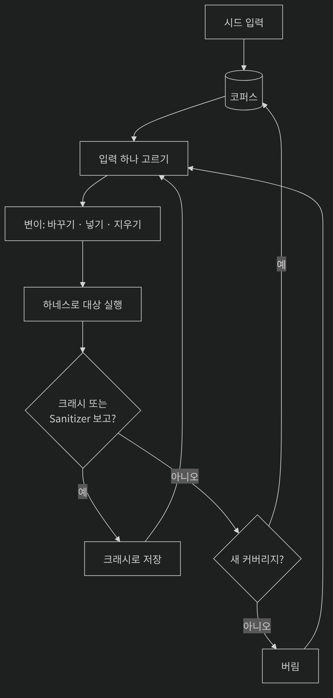

# 퍼징과 퍼저: 개념과 종류, 도구 비교

이 미션을 시작할 때 내가 아는 퍼징은 딱 한 줄이었다. "프로그램에 무작위 값을 마구 넣어서 터지는 곳을 찾는 것."

틀린 말은 아니다. 그런데 공부해 보니 퍼저는 생각보다 훨씬 덜 무작위였다. 아무렇게나 던지는 게 아니라, 던져 본 결과를 보고 다음에 무엇을 던질지 골랐다.

## 1. 사람 대신 퍼저를 쓰는 이유

수만 줄짜리 프로그램에서 입력을 처리하는 부분을 사람이 한 줄씩 읽으며 버그를 찾는다고 해 보자. 할 수는 있지만 오래 걸리고, 읽다 보면 집중력도 떨어진다.

퍼징(fuzzing)은 이 일을 기계에 맡기는 테스트 방법이다. 입력을 자동으로 만들어 프로그램에 계속 넣고, 프로그램이 죽거나 이상하게 동작하는 순간을 잡아낸다. 이 일을 실제로 하는 도구가 퍼저(fuzzer)다.

퍼저가 "이 입력을 넣었더니 터졌다"고 알려 주면, 사람은 그 지점부터 들여다보면 된다. 코드 전체를 읽는 대신 볼 곳을 좁혀 주는 셈이다.

다만 아무 데나 쓸 수 있는 건 아니다. 퍼징은 파일 파서, 이미지 디코더, 네트워크 패킷 처리처럼 외부 입력을 받아서 처리하는 코드에 잘 맞는다. 입력과 관계없는 설계 실수나 권한 설정 문제는 퍼저가 찾아 주지 않는다.

## 2. 그냥 전부 넣어 보면 안 될까

처음 든 생각은 이랬다. 컴퓨터는 빠르니까 가능한 입력을 전부 넣어 보면 되지 않을까?

계산해 보면 바로 포기하게 된다. 1바이트가 가질 수 있는 값은 256가지다. 4바이트면 256⁴ = 2³², 약 43억 가지다. 100바이트짜리 파일이라면 경우의 수가 10의 240제곱쯤 되는데, 이건 관측 가능한 우주의 원자 수(약 10의 80제곱)보다 훨씬 크다. 전부 넣어 보는 건 불가능하다.

그래서 나는 퍼저가 "대표값"을 골라 넣을 거라고 추측했다. 타입의 끝값, 아주 큰 크기, 특수 문자 같은 것들 말이다. 이 추측은 반쯤 맞았다. AFL 계열 퍼저는 변이할 때 입력의 바이트를 0, 1, -1, 127처럼 경계에 걸리기 쉬운 값으로 바꿔 보는 기능을 실제로 가지고 있다. 개발자는 경계 조건에서 실수를 많이 하기 때문이다.

나머지 반은 내가 몰랐던 부분이다. 퍼저는 입력을 넣은 뒤 프로그램이 **어디까지 실행됐는지**를 보고, 그걸 근거로 다음 입력을 고른다. 이 방식을 커버리지 피드백이라고 부른다.

## 3. 퍼저를 이루는 재료들

### 시드: 출발점이 되는 입력

시드(seed)는 퍼저에게 처음 쥐여 주는 입력이다. 퍼저는 이걸 조금씩 바꿔 가며 새 입력을 만든다.

시드는 아무거나 넣어도 돌아가긴 하지만, 대상이 받아들이는 유효한 형식이면 훨씬 좋다. 유효한 예시를 시드로 사용하면 퍼저가 더 유의미한 입력 값을 생성하여 소프트웨어의 깊숙한 영역까지 탐색할 수 있다.

PNG 이미지를 읽는 프로그램으로 생각해 보자. PNG 파일은 맨 앞 8바이트가 `89 50 4E 47 0D 0A 1A 0A`로 정해져 있다. 무작위 바이트를 넣으면 거의 다 이 첫 검사에서 "PNG가 아님"으로 튕겨 나가서, 정작 버그가 숨어 있을 법한 이미지 해석 코드까지 가지 못한다. 진짜 PNG 파일을 시드로 주면 첫 관문을 통과한 상태에서 변형이 시작된다.

### 변이: 입력을 조금씩 바꾸기

변이(mutation)는 기존 입력을 바꿔 새 입력을 만드는 작업이다. 비트 하나 뒤집기, 숫자에 값 더하고 빼기, 중간에 바이트 끼워 넣기, 일부 잘라 내기, 두 입력 이어 붙이기 같은 것들이다. 이 일을 맡은 부품을 변이기(mutator)라고 부른다.

### 하네스: 퍼저와 프로그램을 잇는 코드

하네스(harness)는 퍼저가 만든 입력을 검사하고 싶은 함수에 넘겨 주는 짧은 연결 코드다. JSON 파서를 검사하고 싶다면 "입력 바이트를 받아서 파싱 함수에 넘긴다"는 몇 줄짜리 함수를 쓰면 된다.

처음엔 퍼저가 이것까지 알아서 만들어 주는지 궁금했는데, 보통은 사람이 쓴다. 어떤 함수를 검사할지 고르는 것부터가 판단이 필요한 일이기 때문이다. AI가 하네스 작성을 돕기도 하지만, 제대로 만들어졌는지 확인하는 건 여전히 사람 몫이다.

### 계측과 커버리지: 어디까지 실행됐는지 기록하기

계측(instrumentation)은 프로그램 곳곳에 작은 기록 장치를 심는 것이다. 소스코드가 있으면 보통 컴파일할 때 분기마다 "여기를 지나감"을 표시하는 코드를 끼워 넣는다. 소스가 없으면 실행 중인 바이너리에 기록 장치를 끼워 넣거나, 에뮬레이터 위에서 실행하며 기록하는 방법을 쓴다.

이렇게 모은 "어느 코드를 지나갔는가"라는 정보가 커버리지(coverage)다. 예를 들어 AFL 계열 퍼저는 "어느 코드 블록에서 어느 블록으로 넘어갔는지"를 작은 표(비트맵)에 기록한다.

여기서 내가 헷갈렸던 게 있다. 커버리지가 입력을 만드는 건가? 아니다. 입력은 변이기가 만든다. 커버리지는 그 입력을 넣었더니 프로그램이 어디까지 갔는지 알려 주는 결과 보고서에 가깝다.

### 코퍼스: 쓸모 있었던 입력 모음

코퍼스(corpus)는 시드와, 퍼저가 쓸모 있다고 판단해 보관한 입력들의 모음이다. 퍼저가 실행한 입력을 전부 저장하는 게 아니다. 처음 보는 경로를 지났거나, 같은 경로라도 반복문을 도는 횟수가 눈에 띄게 달라진 입력만 남기고 나머지는 버린다. (libFuzzer는 같은 경로를 지나는 더 짧은 입력이 나오면 기존 입력을 그걸로 바꾸기도 한다.)

### 사전: 넣어 볼 만한 단어 목록

`.dict` 파일은 입력에 끼워 넣어 볼 만한 단어나 바이트 조각을 모은 목록이다. 형식은 이런 식이다.

```
header_png="\x89PNG\x0d\x0a\x1a\x0a"
chunk_ihdr="IHDR"
chunk_idat="IDAT"
```

이것도 누가 관리하는지 궁금했는데, 대개 사람이 파일 형식 명세나 실제 파일을 보고 골라 둔다. Google Fuzzing 자료에도 PNG, JSON, SQL, HTTP 같은 형식별 사전이 모여 있다.

사전은 필수가 아니라 힌트다. 바이트를 하나씩 무작위로 바꿔서 `IHDR` 네 글자를 정확히 맞추기는 어려우니, 아예 통째로 넣어 보라고 쥐여 주는 것이다. 참고로 AFL++에는 컴파일하면서 코드 안의 비교값을 뽑아 사전을 자동으로 만드는 기능도 있는데, 사람이 관리하는 `.dict` 파일과는 별개의 기능이다.

### 한 번에 정리

|용어|한 줄 요약|
|---|---|
|시드 (seed)|처음 쥐여 주는 입력. 유효한 형식일수록 깊이 들어간다|
|변이 (mutation)|입력을 조금씩 바꿔 새 입력을 만드는 것|
|하네스 (harness)|퍼저의 입력을 검사할 함수에 넘겨 주는 연결 코드. 보통 사람이 쓴다|
|계측 (instrumentation)|실행 경로를 기록하도록 심어 둔 기록 장치|
|커버리지 (coverage)|입력이 어떤 코드를 지나갔는지에 대한 기록|
|코퍼스 (corpus)|시드 + 새 커버리지를 만든 입력들의 모음|
|사전 (dictionary)|넣어 볼 만한 토큰 목록. 선택 사항|

## 4. 퍼저가 한 바퀴 도는 과정

재료가 갖춰지면 퍼저는 아래 과정을 계속 반복한다.

1. 코퍼스에서 입력 하나를 고른다.
2. 변이로 조금 바꾼다.
3. 하네스를 통해 대상 프로그램에 넣고 실행한다.
4. 프로그램이 죽었거나 Sanitizer(뒤에서 설명)가 오류를 보고하면, 그 입력을 크래시로 따로 저장한다.
5. 아무 문제 없이 끝났다면 커버리지를 확인한다. 새 커버리지가 나왔으면(처음 보는 경로를 지났거나, 같은 경로를 지난 횟수가 크게 달라졌으면) 코퍼스에 추가하고, 아니면 버린다.
6. 다시 1번으로.

그림으로 그리면 이렇다.

크래시를 찾은 뒤의 동작은 도구마다 다르다. libFuzzer는 기본 설정에서 첫 크래시를 저장하고 멈추고, AFL++는 크래시를 저장한 뒤 계속 탐색한다.

이 방식이 돌아가려면 실행 경로를 볼 수 있어야 한다. 그래서 소스가 있으면 컴파일할 때 계측하고, 없으면 바이너리 계측이나 에뮬레이터를 쓴다.

왜 굳이 새 경로를 연 입력을 남길까. 그 입력은 프로그램의 새 구역으로 들어가는 문을 열어 둔 입력이기 때문이다. 그걸 바탕으로 다시 변형하면 문 너머까지 갈 가능성이 높다. 퍼저는 이 과정을 초당 수천 번 이상 돌면서 코퍼스를 조금씩 키워 가고, 코퍼스가 커질수록 프로그램의 더 많은 부분에 닿게 된다.

## 5. 직접 따라가 보기: `FUZ` 세 글자가 버그를 찾기까지

Google Fuzzing의 libFuzzer 튜토리얼에 나오는 `fuzz_me.cc` 예제다.

```cpp
#include <stdint.h>
#include <stddef.h>

bool FuzzMe(const uint8_t *Data, size_t DataSize) {
  return DataSize >= 3 &&
         Data[0] == 'F' &&
         Data[1] == 'U' &&
         Data[2] == 'Z' &&
         Data[3] == 'Z';
}

extern "C" int LLVMFuzzerTestOneInput(const uint8_t *Data, size_t Size) {
  FuzzMe(Data, Size);
  return 0;
}
```

`FuzzMe`는 입력이 `FUZZ`인지 확인하는 함수다. 아래쪽 `LLVMFuzzerTestOneInput`이 하네스이고, libFuzzer는 이 함수에 입력을 바꿔 가며 계속 넣는다.

그런데 이 코드에는 버그가 있다. 길이가 3 이상인지만 확인해 놓고 `Data[3]`, 즉 네 번째 바이트까지 읽는다. 입력 길이가 딱 3이면 버퍼 밖을 읽게 된다.

퍼저가 이 버그를 찾아가는 데 핵심 역할을 하는 건 `&&`다. `&&`는 앞 조건이 거짓이면 뒤 조건을 아예 검사하지 않는다. 이걸 단락 평가(short-circuit evaluation)라고 한다. 그래서 첫 글자가 F가 아닌 입력은 첫 비교에서 끝나고, F로 시작하는 입력은 한 줄 더 내려간다. 맞힌 글자가 늘수록 실행되는 비교가 늘어나고, 퍼저는 이 차이를 커버리지로 알아챈다.

코퍼스에 이미 첫 비교에서 떨어지는 입력이 있다고 치고, 흐름을 따라가 보자.

```
입력   어디까지 갔나                      퍼저의 판단
AAAA   Data[0]=='F' 에서 실패            이미 본 경로 → 버림
FAAA   Data[0] 통과, Data[1]에서 실패     새 경로 → 코퍼스에 저장
FUAA   Data[1] 통과, Data[2]에서 실패     새 경로 → 저장
FUZA   Data[2] 통과, Data[3]에서 실패     새 경로 → 저장
FUZ    Data[2] 통과, 없는 Data[3]을 읽음   버퍼 밖 읽기 발생
```

퍼저는 `FUZZ`라는 정답을 미리 알지 못한다. 실제로는 한 줄과 다음 줄 사이에 수많은 헛발질이 있다. 무작위로 한 바이트를 바꿔서 그게 하필 첫 번째 자리이고 하필 `F`일 확률은 낮으니까. 다만 한 번 `FAAA`가 코퍼스에 들어가면, 다음부터는 `FAAA`를 바탕으로 변형하기 때문에 처음부터 다시 맞힐 필요가 없다. 한 글자씩 단계를 밟아 올라가는 셈이다.

마지막 `FUZ`는 `FUZA`에서 마지막 바이트를 지우는 변이 한 번이면 나온다. 길이가 3이니 `DataSize >= 3`은 통과하고, `Data[2]`까지 맞으니 `Data[3]`을 읽으러 간다. 그런데 네 번째 바이트는 없다.

참고로 실제 libFuzzer나 AFL++는 비교 연산에 쓰인 값(`'F'`, `'U'` 같은)을 엿보고 그 값을 입력에 넣어 보는 기능이 있어서, 위 과정보다 훨씬 빨리 찾는다. libFuzzer는 이 기능이 기본으로 켜져 있고, AFL++는 CmpLog라는 이름으로 따로 켜야 한다. 그래도 정답을 미리 아는 건 아니다. 후보를 넣어 보고 결과로 확인하는 구조는 같다.

## 6. Sanitizer: 조용한 버그를 시끄럽게 만들기

여기서 이상한 점이 하나 있다. C/C++에서 배열 범위를 넘어 읽으면 프로그램이 바로 죽을까?

대부분 안 죽는다. Java나 Python과 달리 C/C++는 범위 검사를 하지 않아서, 버퍼 바로 뒤에 있는 엉뚱한 메모리를 조용히 읽고 그냥 지나간다. 실제로 Sanitizer 없이 위 예제에 `FUZ`를 넣으면 아무 일 없이 끝난다. 그러면 퍼저 입장에서 `FUZ`는 `FUZA`와 같은 경로를 지난 평범한 입력일 뿐, 버그로 보고되지 않는다. 버그를 밟고도 모르고 지나가는 것이다.

이걸 잡아 주는 게 Sanitizer다. 대표적인 AddressSanitizer(ASan)는 두 가지 일을 한다. 컴파일할 때는 메모리를 읽고 쓰는 곳마다 "이 주소에 접근해도 되는가"를 확인하는 코드를 끼워 넣는다. 실행할 때는 메모리를 할당할 때마다 그 앞뒤에 접근 금지 구역을 만들어 둔다. 그래서 버퍼 끝에서 한 바이트만 넘어가도 금지 구역을 밟은 게 바로 걸린다. ASan을 켜고 `FUZ`를 넣으면 이런 보고가 나온다.

```
#예시 출력
==ERROR: AddressSanitizer: heap-buffer-overflow on address 0x502000000053 ...
READ of size 1 at 0x502000000053 thread T0
    #0 ... in FuzzMe(unsigned char const*, unsigned long) fuzz_me.cc:9
    #1 ... in LLVMFuzzerTestOneInput fuzz_me.cc:13
0x502000000053 is located 0 bytes after 3-byte region [0x502000000050,0x502000000053)
```

읽어 보면 꽤 친절하다. 3바이트짜리 메모리 바로 뒤(`0 bytes after 3-byte region`)를 1바이트 읽었고(`READ of size 1`), 그 위치는 `fuzz_me.cc` 9번째 줄, 즉 `Data[3] == 'Z'`라는 뜻이다.

처음엔 Sanitizer를 예외처리 같은 건 줄 알았다. 둘은 방향이 반대다. `try/catch` 같은 예외처리는 문제가 생겨도 프로그램이 계속 돌아가도록 수습하는 장치다. Sanitizer는 문제를 찾아서 크게 알리는 진단 도구다. 개발하고 테스트할 때 켜는 것이고, 실행 속도가 느려지기 때문에(ASan은 대략 2배) 실제 서비스 배포용은 아니다.

자주 쓰는 Sanitizer는 세 가지다.

- **ASan** (AddressSanitizer): 버퍼 범위 초과, 해제한 메모리를 다시 사용하는 use-after-free 같은 메모리 오류
- **UBSan** (UndefinedBehaviorSanitizer): 부호 있는 정수 오버플로 같은, C/C++에서 결과가 정의되지 않은 동작 일부
- **MSan** (MemorySanitizer): 초기화하지 않은 메모리 값을 조건문이나 주소 계산에 사용하는 경우

멈추는 방식에도 차이가 있다. ASan은 오류를 찾으면 바로 프로그램을 멈춘다. UBSan은 기본 설정에서 경고만 출력하고 계속 실행하기 때문에, 퍼징할 때는 `-fno-sanitize-recover=all` 옵션으로 멈추게 해 둬야 퍼저가 크래시로 알아챈다.

그리고 켜 둔 종류의 오류만 잡으므로, Sanitizer를 켰다고 모든 버그가 잡히는 건 아니다.

## 7. 분기를 만나면 퍼저는 어느 쪽으로 가나

공부하다가 가장 오래 붙잡고 있던 질문이다. 메모에 이렇게 적어 두었다.

> 퍼저가 분기를 만났을 때 일단 한 방향으로 나아갈 거 아니야? 그럼 모든 영역을 탐색하려면 나중에 돌아와야 하는데, 이때 쓰이는 게 코퍼스나 커버리지인가? 분기가 나오면 무조건 두 방향을 다 검사하나, 아니면 하나만 골라서 더 깊게 파고드나?

답부터 말하면, 퍼저는 분기에서 방향을 고르지 않는다. 방향은 입력이 정한다. 입력을 넣으면 프로그램은 그 입력에 맞는 길 하나로 쭉 실행될 뿐이고, 퍼저는 실행이 끝난 뒤 "이번엔 어느 길로 갔나"를 커버리지로 확인한다.

그러면 "나중에 돌아온다"는 건 뭘까. 내 추측대로 코퍼스가 그 역할을 한다. 코퍼스에는 각 갈림길까지 도달했던 입력들이 남아 있다. 퍼저가 그중 하나를 다시 꺼내 변형하면, 그 갈림길 앞에서 다른 방향을 시도해 보는 것과 같은 효과가 난다. 어떤 입력을 얼마나 자주 꺼낼지는 퍼저의 스케줄링 방식이 정한다.

두 방향을 다 검사한다는 보장은 없다. 이런 코드를 보자.

```c
if (magic == 0xDEADBEEF) {
    process_secret_feature(data);   // 여기 버그가 있다면?
}
```

비교값 엿보기 같은 보조 기능 없이 무작위 변이만 쓴다면, 4바이트를 한 번에 정확히 `0xDEADBEEF`로 맞출 확률은 약 43억분의 1이다. 퍼저가 몇 시간을 돌아도 이 안으로 못 들어갈 수 있다.

메모에는 내 나름의 결론도 적혀 있었다. "결국 효율을 챙기기 위해 실행 수를 줄여서 얻은 부작용이라는 거네." 지금 보면 "부작용"이라는 말은 맞다. 모든 경우를 시험하는 걸 포기한 대가로 닿지 못하는 곳이 생긴다. 다만 "실행 수를 줄인다"는 표현은 고쳐야 한다. 퍼저는 초당 수천 번 이상 실행한다. 줄이는 건 실행 횟수가 아니라 쓸모없는 입력에 낭비하는 실행이다.

이 약점을 메우려는 방법도 여럿 있다.

- **사전**: 그 값을 미리 넣어 둔다. x86처럼 숫자를 리틀엔디언으로 저장하는 환경이라면 메모리에는 `EF BE AD DE` 순서로 놓이므로 `\xEF\xBE\xAD\xDE`를 넣는다.
- **비교값 엿보기**: 프로그램이 무엇과 비교하는지 관찰해서 그 값을 입력에 넣어 본다. libFuzzer의 기본 기능이고, AFL++에서는 CmpLog가 이 역할을 한다.
- **비교 쪼개기**: 4바이트 비교를 1바이트 비교 4개로 나눠서, 한 바이트씩 맞출 때마다 커버리지가 늘어나게 만든다. 위의 `FUZZ` 예제처럼 단계를 밟을 수 있게 되는 것이다. laf-intel이라는 기법으로, AFL++에서 옵션으로 쓸 수 있다.
- **하이브리드 퍼징**: 막히는 분기에서는 조건식을 직접 풀어 주는 화이트박스 기법(뒤에서 설명)을 섞는다.

내가 처음에 상상한 트리 비유도 다시 생각해 봤다. 입력이 단계별로 갈라지며 깊어진다는 점에서는 잘 맞는다. 하지만 두 가지가 다르다. 첫째, 퍼저는 트리를 한쪽 끝까지 내려갔다가 되돌아오는 식으로 순회하지 않는다. 코퍼스라는 입력 묶음에서 계속 하나씩 골라 변형할 뿐이다. 둘째, 실제 프로그램에서는 서로 다른 길이 같은 함수로 다시 모이고, 반복문 때문에 같은 곳을 여러 번 돌기도 한다. 모양이 트리보다는 그물에 가깝다. AFL이 경로를 지났는지뿐 아니라 몇 번 지났는지까지 세는 것도 이 때문이다.

## 8. 커버리지 피드백은 머신러닝일까

결과를 기록하고 그걸 보고 다음 행동을 바꾼다는 점에서 머신러닝처럼 느껴졌다. 겉모습은 비슷하지만 속은 다르다.

머신러닝은 데이터로 모델을 학습시키고, 그 모델이 다음 값을 예측한다. 일반적인 퍼저에는 학습된 모델이 없다. 일단 변형해서 넣어 보고, 새 경로가 나왔으면 남기고 아니면 버린다는 규칙을 엄청 빠르게 반복한다. 어떤 입력을 자주 꺼낼지 결과에 따라 조정하는 정도의 요령은 있지만, 다음 입력을 예측하지는 않는다.

더 가까운 비유는 유전 알고리즘이다. 쓸모 있는 개체(입력)만 살아남고, 그 개체를 변형해서 다음 세대를 만든다. 실제로 AFL은 자기 자신을 유전 알고리즘을 쓰는 퍼저라고 소개한다. 신경망으로 변이를 안내하려는 연구도 있지만, 지금 널리 쓰이는 퍼저들의 기본 구조는 아니다.

## 9. 퍼저를 나누는 두 개의 축

처음엔 블랙박스, 그레이박스, 화이트박스를 "소스코드를 볼 수 있느냐"로 나누는 줄 알았다. 실제 기준은 **퍼저가 프로그램 내부 정보를 얼마나 활용하느냐**다.

- **블랙박스**: 프로그램 안을 보지 않는다. 입력을 넣고 죽었는지 안 죽었는지 같은 바깥 결과만 본다. 빠르고 간단하지만 깊은 곳까지 가기 어렵다.
- **그레이박스**: 커버리지 같은 일부 내부 정보를 활용한다. AFL, AFL++, libFuzzer, honggfuzz가 여기에 속한다.
- **화이트박스**: 코드의 조건식을 분석해서 "이 분기를 통과하려면 입력이 어떤 값이어야 하는가"를 계산한다. 기호 실행(symbolic execution)이 대표적인 기법이고, Microsoft의 SAGE가 유명한 예다. 까다로운 분기 조건도 풀 수 있지만, 프로그램이 커지면 따져야 할 경로가 폭발적으로 늘어나서 계산 비용이 크고 놓치는 경로도 생긴다.

소스코드 유무와 꼭 일치하지는 않는다. 소스가 없어도 바이너리를 계측해서 커버리지를 얻을 수 있고, 소스가 있어도 커버리지를 쓰지 않는 퍼저를 돌릴 수 있다. 위에서 예로 든 SAGE도 소스 없이 바이너리를 대상으로 동작한 화이트박스 퍼저였다.

이와 별개로 **입력을 어떻게 만드느냐**라는 축도 있다.

- **변이 기반**: 기존 입력을 바꿔서 만든다. 위에서 본 방식이다.
- **생성 기반**: 문법이나 형식 규칙으로 입력을 처음부터 만든다.
- **구조 인식 기반(structure-aware)**: 입력 구조를 이해하고, 구조가 깨지지 않는 선에서 변형한다. 변이 기반과 겹치는 경우가 많다.

두 축은 독립적이다. 문법 기반으로 입력을 만들면서 커버리지도 활용하는 퍼저가 있을 수 있고, 실제로 있다. 앞에서 본 `.dict` 사전은 어느 축의 분류 기준도 아니고, 여러 종류의 퍼저가 함께 쓰는 보조 자료다.

공부하면서 내린 정리는 이렇다. 요즘 실무에서 많이 쓰는 퍼저는 대부분 변이 기반에 커버리지를 쓰는 그레이박스다. 그리고 이런 오픈소스 퍼저를 가져와서, 하네스, 시드, 사전, 필요하면 커스텀 변이기까지 분석할 대상에 맞게 다듬어 쓰는 경우가 많다.

## 10. 퍼저 두 개 비교: AFL++와 Jackalope

둘 다 커버리지를 쓰는 퍼저다. 가장 큰 차이는 무엇을 대상으로, 어떻게 커버리지를 얻느냐에 있다.

||AFL++|Jackalope|
|---|---|---|
|만든 곳|Michał Zalewski가 만든 AFL을 이어받은 커뮤니티 포크|Google Project Zero|
|목표|빠르고 기능이 많은 범용 퍼저|소스 없는 바이너리를 대상에 맞게 고쳐 쓰기 쉽고, 여러 대로 나눠 돌리기 쉬운 퍼저|
|소스가 있을 때|컴파일할 때 계측 (`afl-cc`)|Linux에서 Sanitizer Coverage 모드|
|소스가 없을 때|QEMU, FRIDA, Unicorn, Nyx 모드. Windows PE 파일은 QEMU+Wine|TinyInst로 바이너리 계측 (Windows, macOS, Linux, Android)|
|눈에 띄는 기능|CmpLog(비교값 엿보기), 다양한 변이 전략, 커스텀 변이기|서버가 여러 퍼저의 입력과 커버리지를 모으는 분산 구조, 문법 기반 변이 엔진|
|스스로 밝힌 한계|소스 없는 대상은 소스가 있을 때보다 느리다|고급 변이 전략은 넣지 않았고, 일반적인 변이기만 제공|

여기서 헷갈리기 쉬운 부분이 있다. Jackalope 공식 설명에는 "black-box 바이너리를 다룰 수 있는 퍼저"라고 나온다. 여기서 black-box는 소스가 없는 바이너리라는 뜻이다. 퍼저가 내부 정보를 안 본다는 뜻이 아니다. Jackalope는 바이너리를 계측해서 커버리지를 쓰기 때문에, 9장의 기준으로 보면 그레이박스 방식이다. 소스코드 접근성만 보고 Jackalope를 블랙박스 퍼저라고 부르면 틀린다.

## 11. 크래시를 찾았다 = 취약점을 찾았다?

아니다. 퍼저가 찾은 건 "이 입력을 넣으면 프로그램이 이상해진다"는 사실까지다. 그 뒤는 사람이 확인해야 한다.

1. **재현**: 같은 입력으로 다시 넣어도 똑같이 터지는가.
2. **최소화**: 입력에서 크래시와 상관없는 부분을 걷어 낸다. 퍼저가 찾은 입력은 쓸데없는 바이트가 많이 붙어 있기 마련이다.
3. **중복 정리**: 크래시 수백 개가 사실 같은 버그 하나에서 나온 경우가 흔하다.
4. **원인 분석**: 정확히 어느 코드에서 무엇이 잘못됐는가.
5. **영향 판단**: 공격자가 이 입력을 넣을 수 있는가, 메모리를 읽기만 하는가 쓸 수도 있는가.

위 `FUZ` 예제라면 1바이트를 범위 밖에서 읽는 버그다. 버그인 건 맞지만, 공격자가 그걸로 할 수 있는 일은 많지 않다. 같은 범위 초과라도 쓰기가 가능했다면 이야기가 크게 달라진다.

반대로 커버리지가 늘었다고 버그가 있다는 뜻도 아니고, 퍼저가 오래 돌아도 아무것도 못 찾았다고 버그가 없다는 뜻도 아니다.

## 12. 퍼징은 얼마나 큰 분야일까

처음에 궁금했던 것 중 하나가 이거였다. 퍼징은 아이디어가 단순하니까 쓰임새도 좁은 게 아닐까?

원리만 놓고 보면 4장의 여섯 단계가 거의 전부다. 그런데 찾아보니 이 여섯 단계를 대상마다 다르게 구현한 퍼저가 계속 나온다. 구글은 OSS-Fuzz로 수많은 오픈소스 프로젝트를 상시 퍼징하고 있고, 운영체제 커널을 퍼징하는 syzkaller(리눅스 커널에서 가장 많이 쓰인다), 자바스크립트 엔진을 퍼징하는 Fuzzilli처럼 특정 종류의 대상에 맞춘 퍼저도 따로 있다. 커널에 넣는 입력은 파일이 아니라 시스템 콜의 나열이고, 자바스크립트 엔진에 넣는 입력은 문법이 맞는 코드여야 하니, 입력 모양부터 하네스까지 전부 달라진다.

반대로 한계도 분명하다. 입력을 넣어서 검사할 수 있는 대상이어야 하고, 하네스와 시드를 얼마나 잘 준비하느냐에 결과가 크게 달라진다.

## 마치며

미션을 시작할 때와 끝났을 때 퍼징에 대한 이해가 달라진 점은 입력값을 바꾸고 고르는 방식이다. 무작위로 바꾸는 건 맞지만, 그 결과를 보고 어떤 입력을 남길지 고르는 데서 퍼저의 효율이 나온다. 모든 입력을 시험할 수는 없으니 커버리지, 코퍼스, 계측으로 효율을 챙기고, 그 대가로 닿지 못하는 분기가 생긴다. 그래서 퍼저가 아무것도 못 찾았다고 해서 버그가 없다고 말할 수는 없다. 퍼저가 해 주는 건 사람이 먼저 들여다볼 곳을 짚어 주는 것까지다.

## 참고 자료

- Google Fuzzing 자료 모음: https://github.com/google/fuzzing
- libFuzzer 튜토리얼 (`fuzz_me.cc` 예제): https://github.com/google/fuzzing/blob/master/tutorial/libFuzzerTutorial.md
- AFL++: https://github.com/AFLplusplus/AFLplusplus
- AFL++ 바이너리 전용 퍼징 문서: https://github.com/AFLplusplus/AFLplusplus/blob/stable/docs/fuzzing_binary-only_targets.md
- Jackalope: https://github.com/googleprojectzero/Jackalope
- AddressSanitizer 문서: https://clang.llvm.org/docs/AddressSanitizer.html
